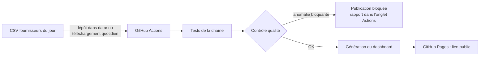

# MyBestSim · test de recrutement

Deux livrables, publiés sur GitHub Pages par le même dépôt :

| Livrable | Adresse une fois publié |
| --- | --- |
| Partie 1 : dashboard eSIM Insights | `https://<utilisateur>.github.io/<dépôt>/` |
| Partie 1 : même dashboard, présentation « rapport BI » | `https://<utilisateur>.github.io/<dépôt>/powerbi/` |
| Partie 2 : article « Internet en croisière : quelle eSIM choisir ? » | `https://<utilisateur>.github.io/<dépôt>/article/` |

## Partie 1 : l'automatisation

Trois façons de mettre à jour les données, de la plus simple à la plus automatique :

1. **Dans le navigateur, sans rien installer** : bouton « Importer des CSV » (ou glisser-déposer sur la page). Les fichiers sont contrôlés puis les statistiques recalculées sur place. Rien n'est envoyé sur un serveur. Un fichier invalide est refusé, avec la ligne en cause.
2. **En déposant les CSV dans `data/`** sur GitHub : le workflow teste, contrôle, régénère et republie le site en 1 à 2 minutes.
3. **Entièrement automatique** : avec le secret `CSV_ZIP_URL` (adresse de l'archive du jour), le workflow télécharge les CSV chaque matin à 05:17 UTC et republie.

### Contrôle qualité (`dashboard/quality.py`)

À chaque import, aucune ligne n'est modifiée : le contrôle décide seulement si l'on publie.

| Niveau | Contrôles |
| --- | --- |
| **Bloquant** (pas de publication) | colonnes obligatoires, SKU vide ou en double, fournisseur vide ou plusieurs par fichier, prix non numérique ou ≤ 0, durée invalide, volume non numérique |
| **Alerte** (publié, signalé) | devise autre que EUR, réseau hors 4G/5G, recharge hors oui/non, volume incohérent avec son libellé, code pays avec plusieurs noms, espaces parasites, prix > 1 000 €, fichier vide |

Le rapport est écrit dans `site/quality.json`, affiché dans le résumé du workflow GitHub et dans la carte « Qualité des données » du dashboard. Sur les données de test : 0 erreur, 0 alerte.

### Tests (`tests/test_pipeline.py`)

`python -m unittest discover -s tests -v`, exécutés avant chaque publication :

- les 6 statistiques de référence (5 056 cartes, 56 à plus de 100 €, 5,36–154,63 €, 29,30 €, 14,5 Go, 18 fournisseurs) ;
- un prix invalide, un SKU en double ou une colonne manquante bloquent la publication ;
- une devise inattendue déclenche une alerte sans bloquer ;
- un nouveau fichier fournisseur est pris en compte automatiquement.

### Fichiers

- `dashboard/template.html` : l'interface (deux vues, filtres, graphiques Chart.js, import CSV, qualité).
- `dashboard/logos/` : logos officiels (`<Fournisseur>.png`, même nom que la colonne `provider`) et logo MyBestSim. Un logo déposé est intégré à la génération suivante.
- `dashboard/powerbi.html` : la même analyse en présentation « rapport BI » (3 onglets, matrice, tops 5, classement des fournisseurs).
- `dashboard/build.py` : contrôle, génération de `site/index.html` et `site/powerbi/index.html`. Python standard, sans dépendance.
- En local : `python dashboard/build.py` puis ouvrir `site/index.html`.

### Statistiques demandées et règles de calcul

| # | Statistique | Valeur sur les données de test | Où dans le dashboard |
| --- | --- | --- | --- |
| 1 | Nombre total de cartes eSIM | 5 056 | KPI « Cartes eSIM » |
| 2 | Produits à plus de 100 € | 56 (strictement > 100 €) | Bandeau prix, à droite |
| 3 | Fourchette de prix | 5,36 € → 154,63 € | Bandeau prix, à gauche |
| 4 | Data moyenne par carte | 14,5 Go | KPI « Data moyenne par carte » |
| 5 | Prix moyen global | 29,30 € | KPI « Prix moyen » |
| 6 | Répartition par fournisseur | 18 fournisseurs | Graphique « Offres par fournisseur » et tableau comparatif |
| 7 | Bonus | voir ci-dessous | Page « Market & Pricing » |

Choix assumés :

- **Offres « Illimité »** (colonne `data_gb` vide, 653 offres) : exclues de la data moyenne et du prix par Go, car on ne peut pas leur attribuer un volume. Elles restent comptées partout ailleurs.
- **Doublons** : aucun SKU en double dans les données ; chaque SKU distinct est conservé.
- **Destinations** : les classements par pays excluent les forfaits régionaux (Europe, Asie, Amérique du Nord, Monde).

Bonus : filtres combinables (fournisseur, destination, volume, validité, réseau, prix maximum), tuiles partenaires cliquables avec nombre d'offres et prix d'entrée, comparatif des fournisseurs (part, prix moyen, fourchette, prix par Go, part 5G), fourchette de prix par fournisseur, prix moyen par volume, par durée et croisé volume × durée, distribution des prix, destinations les plus couvertes et leur prix moyen, top 5 des offres les plus chères et des meilleurs prix au Go, import de CSV directement dans le navigateur, rapport de qualité des données.

## Partie 2 : l'article

- `article/template.html` : l'article, `article/build.py` : génération de la FAQ (HTML + données structurées FAQPage identiques), logo intégré, typographie française.
- Recherche : 10 pages concurrentes analysées, prix relevés sur les sources officielles et datés, liste des informations non vérifiées tenue à part.

## Comment j'ai utilisé l'IA

<!-- À réécrire avec tes propres mots avant l'envoi -->
J'ai travaillé avec Claude (Anthropic) en mode agent. Pour le dashboard : profilage et contrôle qualité des CSV, vérification des statistiques par script, refonte de l'interface, tests automatisés de la chaîne d'import et des filtres, captures desktop et mobile. Pour l'article : recherche web, analyse de 10 pages concurrentes, vérification de chaque prix sur sa source, rédaction après validation du plan. Je relisais chaque étape et j'ai fait retirer tout chiffre sans source vérifiable.
